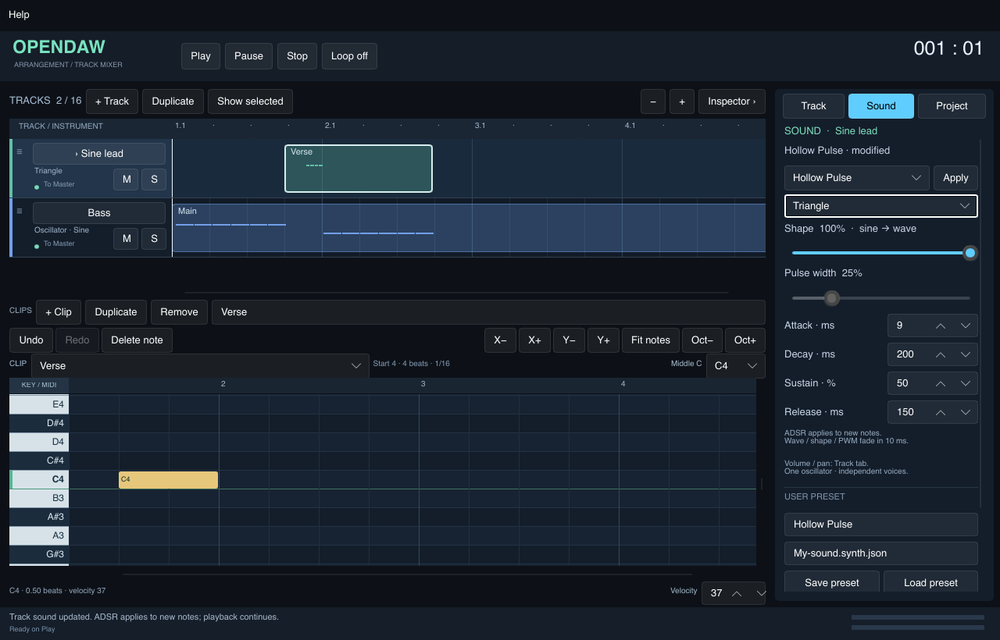
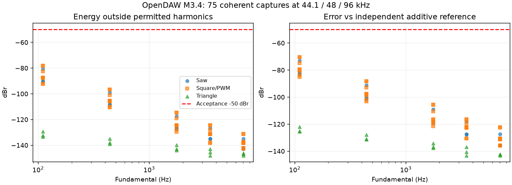
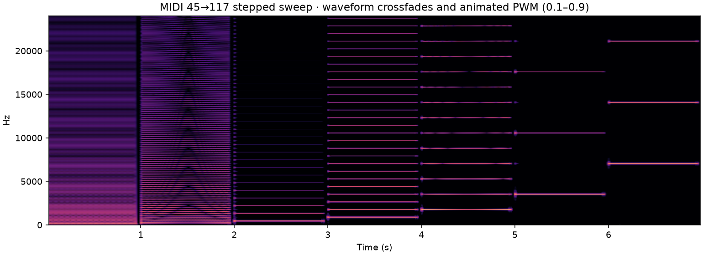

# M3.4 — synth indipendente per traccia

Implementato il 23 ottobre 2026 nel checkout aggiornato
`/Users/giorgiofausto.canu/Downloads/OpenDAW_Interactive`, partendo da `e0f33f4`
(M3.3). Nessun recupero dello ZIP precedente. C++20, Rust/Slint e lockfile conservati.

## Uso

1. Seleziona una traccia oscillatore e apri **Sound** nell'inspector.
2. Scegli Sine, Saw, Square / PWM o Triangle. Shape sfuma linearmente da sine alla
   forma scelta; è disabilitato su sine. Pulse width funziona su Square / PWM.
3. Imposta Attack, Decay e Release in millisecondi e Sustain in percentuale.
   **L'intero ADSR viene acquisito al note-on**: le note già attive, compreso il
   release, conservano i valori precedenti. Waveform, shape e duty agiscono sulle
   voci esistenti con transizioni di 10 ms mantenendo la fase.
4. Seleziona uno dei cinque preset factory e premi **Apply**. Un solo Undo annulla
   l'intero preset. “modified” indica valori diversi dallo snapshot del preset.
5. Per un preset utente, inserisci nome e percorso `.synth.json`, poi **Save preset**.
   **Load preset** valida il file e copia i valori nella traccia selezionata.
   Scorri il pannello per raggiungere questi comandi sulle finestre piccole.
6. Volume/pan restano nella scheda **Track**. I preset del synth conservano questi
   fader e tutte le note. Duplicare una traccia copia il suono e assegna nuovi ID;
   modificare la copia non modifica l'originale.

Un sampler mantiene i controlli WAV nella scheda Track; **Use oscillator instrument**
lo converte nel synth compatibile. Il cambio del tipo resta strutturale e ferma il
playback. I cambi di parametri e preset di un synth esistente continuano in playback.
Gli altri strumenti e le altre tracce restano indipendenti.



## Modello, preset e compatibilità

Nuovo modulo effettivo `app/src/synth.rs`: `Waveform`, `SynthParameters`,
`SynthField`, `SynthPreset`. Cinque snapshot factory originali, senza asset esterni:
Legacy Sine, Warm Saw, Hollow Pulse, Soft Triangle, Short Pluck.

Il progetto resta v2. Il vecchio `{ "kind": "sine" }` è ancora valido e significa
sine, shape 1, duty 0,5, A 0,006 s / D 0,06 s / S 0,75 / R 0,06 s. Non viene
silenziosamente riscritto all'apertura. Una modifica produce `kind: "synth"` con
parametri completi e un eventuale preset posseduto per valore. Il preset contiene
versione 1, nome, provenienza e parametri; “modified” è derivato dal confronto dei
valori e non viene serializzato come un secondo stato autorevole.

Range: shape 0–1, duty 0,05–0,95, attack/decay 0–10 s, sustain 0–1, release 0–20 s.
Tutti i valori devono essere finiti. Zero è un percorso esplicito dell'inviluppo.
Le durate restano in secondi fino al prepare sul sample rate effettivo, senza una
quantizzazione intermedia a 48 kHz; un test con ADSR molto brevi verifica l'uguaglianza
fra configurazione iniziale e target runtime a 44,1/96 kHz.
Il parser rifiuta campi sconosciuti, versioni/range errati e duplicati JSON; il file
preset ha limite 4 KiB. Parametri mancanti non vengono completati con default che
potrebbero mascherare un documento danneggiato. `kind: synth` è rifiutato in v1.
Un'app precedente a M3.4 rifiuta il nuovo tipo synth: non promettiamo compatibilità
in lettura verso le vecchie versioni dell'app.

Salvataggio dei preset tramite sostituzione atomica già usata dalla persistenza,
con percorso Windows dedicato. Un errore di lettura/validazione lascia progetto e
storia invariati. Applicare/caricare/salvare il preset registra uno snapshot Undo;
Save preset è un'azione esplicita e Undo ripristina il documento, non cancella il
file appena scritto. I preset non contengono note, routing, gain o pan.

## Contratti UI → controller → engine

- Richieste synth identificano **track ID e instance ID**. Il controller verifica
  entrambi e il tipo corrente prima di modificare il documento. La selezione UI
  successiva non cambia la destinazione di un comando già accodato.
- La UI invia il singolo campo modificato, non una copia potenzialmente obsoleta
  degli altri controlli. Il controller costruisce il nuovo snapshot completo.
  Aggiornamenti contigui dello stesso campo/istanza coalescono; fine gesto e preset
  sono barriere. Il primo snapshot inverso resta il valore iniziale del gesto.
- `Edit::Synth` è realtime; contiene anche il preset completo. Undo/redo e
  duplicazione ripristinano i valori per istanza. Non avviene un rebuild del grafo
  per forma, ADSR, shape, PWM o preset. Gain/pan riusano il mixer esistente.
- Il bridge controlla l'ordine delle coppie track/instance ID compilate e invia
  **mix + synth di tutte le tracce**. Il C++ verifica la generazione di sessione.
- ABI additiva: `od_synth_v1`, `od_track_v3`, `od_parameters_v1`, `od_load_v3`,
  `od_set_parameters_v1`. I layout v1/v2, le vecchie entry point e ABI version 1
  restano disponibili. Size/version/range e array sono verificati prima del commit.
- La coda SPSC esistente ha otto snapshot utilizzabili e al massimo otto letture
  per blocco. Un batch applica insieme il mixer più recente e il synth completo
  più recente; un successivo comando del vecchio mixer non cancella il synth.
- Parametri, target mix e seriale vengono acquisiti a inizio blocco, prima dei
  note-on. Non è automazione a precisione di campione. `od_read_mix_status_v1`
  conferma anche questi snapshot: submitted = accettato, applied = consumato;
  nessuno dei due certifica la fine della rampa.
- Queue-full non modifica lo stato nativo esportabile né il seriale d'uscita. Rust
  conserva il documento desiderato e ritenta il suo snapshot più recente. Stop e
  Panic mantengono i parametri persistenti; Play ricompila il documento se non
  esisteva un consumer che potesse riallinearlo dopo Stop.
- L'accettazione aggiorna anche `od_engine::spec`: `od_export` vede i parametri
  accettati anche prima del consumo della coda. L'export Rust usa il documento
  acquisito all'avvio e un engine indipendente. Modificare poi il live non lo altera.

Restano le convenzioni di identità e revisione di M3.3; questa milestone non
introduce un nuovo protocollo generale di identificazione dei documenti aperti.

## DSP e decisione antialias

Ogni `SynthNode` ha 24 voci fisse con fase, velocity, note ID e ADSR propri. Stealing
resta deterministico: inviluppo più basso, poi voce più vecchia. Frequenza
fondamentale maggiore o uguale a Nyquist: quella nota produce silenzio.

La sine conserva il percorso `sin` e il livello 0,20 preesistente. Per saw e triangle
si preparano due tabelle da 8192+1 campioni per ogni nota MIDI, mediante FFT inversa
a coefficienti armonici. Si ammettono solo armoniche strettamente sotto Nyquist,
con massimo 2047 per limitare memoria e costo di prepare. Questo limite riduce la
banda superiore delle note MIDI più basse; non è un filtro o un controllo implicito.
La saw è traslata di mezzo ciclo per allineare la fondamentale al morph con sine.

Square/PWM è la differenza di due letture della saw limitata, una traslata del duty.
Il termine DC è cancellato. Dividere per `2 * max(duty, 1-duty)` mantiene il picco
nominale della forma geometrica entro 1; il ringing della troncatura armonica non
viene nascosto con clipping. Triangle usa armoniche dispari 1/n², senza integrazione
instabile o drift. Le letture hanno interpolazione lineare.

Un banco occupa **8,001 MiB per sample rate** e può essere condiviso fra tracce e
live/export perché immutabile. Una cache debole limitata a quattro voci usa un mutex
solo durante la preparazione sul thread di controllo; non trattiene banchi inutili.
Nessun mutex, FFT, refcount/trasferimento di ownership, filesystem, log o allocazione
viene introdotto nel callback. Grafo, banchi e risorse si distruggono dopo stop/join.

Forma discreta: crossfade lineare fra pesi correnti e nuova forma per 10 ms.
Shape e duty: rampe lineari della stessa durata; un nuovo target riparte dal valore
corrente senza salto/reset di fase. ADSR è copiato nella voce al note-on. Gain/pan
mantengono lo smoothing di circa 5 ms; mute usa il gate separato di M3.2.

Lo spike numerico riproducibile confronta una semplice correzione **PolyBLEP
quadratica** per saw/pulse con il banco armonico. Nei casi provati il caso peggiore
è circa −15,06 dBr per quella correzione e −78,02 dBr per il banco; non è una
valutazione delle varianti BLEP/BLAMP di ordine superiore. La scelta del banco
include triangle e duty estremi, senza dipendenze DSP né codice di terzi copiato.

Fonti tecniche primarie consultate il 23 ottobre 2026:
[Joe Wright, Synthesising band limited waveforms using wavetables (2000)](https://www.musicdsp.org/en/latest/_downloads/91daec88cb0d79aeb1c21d8afd4e3199/bandlimited.pdf),
[Julius O. Smith, Wavetable Synthesis](https://www.dsprelated.com/freebooks/sasp/Wavetable_Synthesis.html),
[Pekonen, Nam, Smith, Välimäki, IEEE SPL 2012](https://mac.kaist.ac.kr/pubs/PekonenNamSmithValimaki-spletter2012.pdf).
Il PDF JASA indicato nell'handoff non era recuperabile tramite il browser durante
questa verifica; la scelta si basa sulle prove e sulle fonti accessibili sopra.

## Verifiche eseguite

Host: macOS 15.6.1, Apple M4 Pro arm64; toolchain locale conservata. Numeri riferiti
alle esecuzioni salvate in `evidence/m34-*`, non a tutti gli host supportati.

| Verifica | Risultato |
|---|---|
| Gate app, build release e fixture v1 | **36** test headless / **52** con UI; entrambi i binari release compilati; validate/render v1 passati |
| Native CTest | **5 suite**: core originario, 18 controlli service, client C v1/v3, synth M3.4, allocation probe; tutti passati |
| DSP | MIDI 0–127, quattro forme e duty 0,05/0,5/0,95 a 8/44,1/48/96 kHz; zero e limiti ADSR; release durante attack; reset; rampa esatta di 10 ms e retarget durante la rampa |
| Isolamento | Tre synth con forme/preset diversi; duplicazione indipendente; cambiare il synth mutato A non cambia i byte audio di B/C; save/reopen conserva i valori |
| Export | Cinque partizioni fisse e 25 dimensioni casuali bit-identiche; parametri accettati visibili anche a `od_export` prima del callback; confronto WAV con engine preparato sullo stesso snapshot |
| Saturazione e lifecycle | Coda piena, generazione obsoleta, descriptor/range errati, Stop, recupero dell'ultimo documento e mix legacy dopo synth nello stesso batch |
| Memoria/concorrenza | ASan+UBSan: tutte le suite; TSan: service e synth, inclusi snapshot concorrenti; nessun errore rilevato. LeakSanitizer disabilitato sul Mac |
| Heap C++ durante il render | **10.001** render con note, seek, loop, mix, tutte le forme, shape/PWM/ADSR: **new=0, delete=0**. Non è un'intercettazione generale di malloc/free o di tutte le primitive di lock |
| UI | Probe software collegato al controller reale in silent mode: preset/shape/PWM/ADSR a puntatore, combobox waveform, disabilitazione dei campi inattivi, modified, Undo, copia e save/load preset; 1280×820 e 1000×760, 100/200%, immagini ispezionate |

### Misura spettrale sul SynthNode reale

75 acquisizioni coerenti di un secondo a **44.100, 48.000 e 96.000 Hz esatti**;
MIDI 45/69/93/105/117 = 110/440/1760/3520/7040 Hz. Saw, triangle, square con
PWM 0,1/0,5/0,9. Inviluppo costante, velocity 127, rimozione del solo fattore 0,20.
FFT senza finestra né bin di guardia esclusi: sono ammesse solo le armoniche intere
sotto Nyquist; anche DC conta come spuria. Riferimento additivo indipendente con
fase/ampiezza allineate; confronto anche con le forme ingenue campionate.

- Peggiore energia spuria: **−78,19 dBr** (gate ≤−50).
- Miglioramento minimo sulla forma ingenua: **42,42 dB** (gate ≥20).
- Peggiore errore RMS rispetto al riferimento additivo: **−70,43 dBr**.
- Il gate ≤−50 dBr vale anche a 7040 Hz, decisione fissata dopo lo spike.



Il gate è per parametri statici, non una promessa di banda rigorosamente limitata
per qualsiasi modulazione temporale. C'è inoltre un render di sette secondi con
sweep MIDI a passi, cambi forma e PWM animata 0,1–0,9 a 0,5 Hz: nessun clipping,
rampe esercitate e spettrogramma ispezionato. Modulazioni rapide producono bande
laterali; filtri/oversampling e automazione audio-rate non sono introdotti in M3.4.
L'ascolto del [render di movimento](../evidence/m34-motion.wav) su dispositivo reale
rimane da eseguire, anche per valutare timbro, transizioni e stealing.



### Costo DSP

16 tracce × 8 voci sostenute, 48 kHz, 256 frame, 5000 blocchi; snapshot completo di
tutti i synth ogni quattro blocchi, con cambi di forma/shape/PWM. Prepare a freddo
36,04 ms sul controllo; lavoro di `EngineService::render` p95 **0,353 ms**, p99
**0,374 ms**, massimo **0,471 ms**. Buffer e raccolta tempi fuori dalla misura.
Non è il gate M3.6 a 32/64 tracce, né una prova di underrun/scheduler/dispositivo.

### Regressione sonora v1

Il WAV a otto secondi rimane 1.536.044 byte e ha SHA-256:

```text
c5e43d8f56299da06bdc6e2c167ba0690cb858f48cf70c2df676a86f4d501426
```

## Riproduzione delle verifiche

Dalla radice del repository:

```sh
./scripts/validate_app.sh
./scripts/validate_native.sh build/macos-validation
cargo run --manifest-path app/Cargo.toml --locked --example layout_probe
build/macos-validation/synth_tests --spectra build/m34-spectra
python3 scripts/verify_synth_spectra.py build/m34-spectra  # NumPy 2.3.5 nelle prove
python3 scripts/compare_synth_antialias.py               # spike numerico
build/macos-validation/synth_tests --benchmark
build/macos-validation/synth_tests --motion build/m34-motion.wav
```

Per il grafico facoltativo: `scripts/plot_synth_quality.py RESULTS.json MOTION.wav
DESTINATION`, con NumPy e Matplotlib (3.11.2 nella generazione delle evidenze).
Nessuno dei due è una dipendenza di produzione. Il workflow nativo Linux ora
esegue anche il gate FFT con NumPy fissato; i test C++ restano nella matrice
Mac/Windows/Linux. La CI frontend usa il lockfile esistente (`cargo fetch --locked`).
Questa configurazione non certifica che i job remoti siano stati eseguiti qui.

## Consegna e limiti

M3.4 software implementata e verificata come sopra. Scheda Sound, preset completi,
modello/history/persistenza/export, snapshot runtime e DSP antialias sono concreti;
nessun refactor massivo o aggiornamento delle dipendenze Rust. Evidenze M3.1–3
conservate separatamente. Restano **16 tracce e 24 voci per synth**.

La verifica fisica CoreAudio, Windows/WASAPI e macOS Intel resta aperta. Non sono
certificati latenza/underrun né l'ascolto soggettivo. Oscillatori multipli, unison,
filtri, modulazioni, condivisione di una singola istanza/plugin e routing avanzato
restano fasi successive. La drum machine e i relativi asset sono M3.5.
