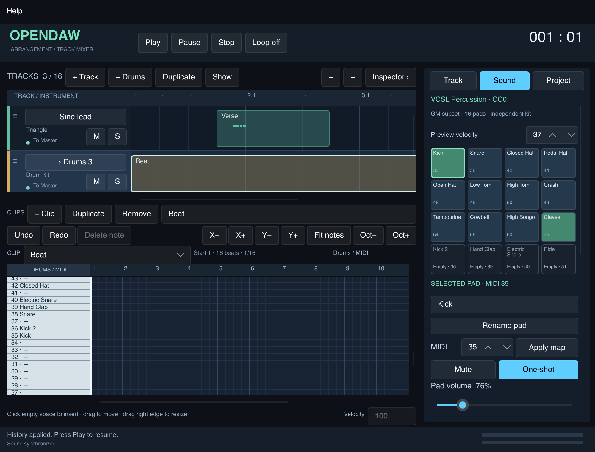
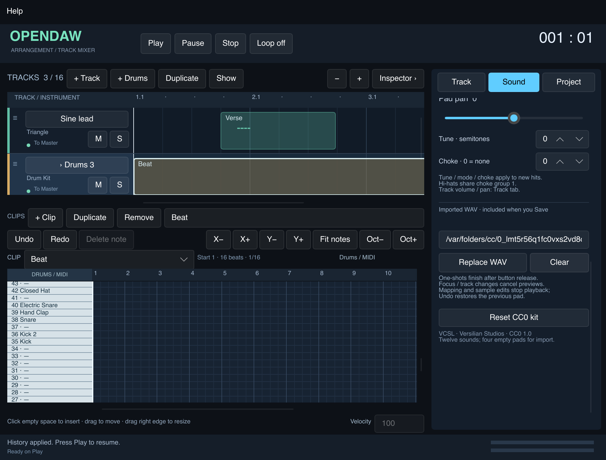

# M3.5 — drum machine interna e kit CC0 verificato

Implementato il 23 ottobre 2026 nel checkout aggiornato
`/Users/giorgiofausto.canu/Downloads/OpenDAW_Interactive`, baseline `ebc0e83`
(M3.4). Nessun recupero dello ZIP precedente. Modifiche incrementali a C++20,
C ABI, modello Rust e UI Slint esistenti.

## Uso

1. Premi **+ Drums** per una traccia indipendente, oppure **Use CC0 drum kit**
   nella scheda Track per convertire la traccia corrente. Apri **Sound**.
2. La griglia 4×4 contiene 12 suoni e quattro pad vuoti. Un clic seleziona il pad
   e avvia la preview alla velocity impostata, senza scrivere note. Il piano roll
   mostra numero MIDI e nome del pad; clic nella griglia scrive una nota.
3. Scorri l'inspector per rinominare, modificare il mapping MIDI, volume, pan,
   mute, tuning, modalità one-shot/gated e choke group del pad selezionato.
   Volume/pan della traccia e mute/solo rimangono nella scheda Track.
4. Inserisci il percorso completo di un WAV e premi **Replace WAV**. **Clear**
   svuota solo il pad; Undo ripristina il campione precedente. Puoi importare anche
   nei quattro pad vuoti. La sorgente importata viene copiata nell'area temporanea
   della sessione; puoi quindi spostare/eliminare l'originale senza perdere Undo.
5. **Save** rende portabile la cartella progetto: include tutti i campioni,
   metadati CC0 e licenza. Non richiede rete o cartelle esterne al riavvio.
6. **Reset CC0 kit** ripristina un kit intero con nuovi pad ID e un solo Undo.
   Duplicare la traccia copia kit, impostazioni e note con nuove identità.

Mapping/import/clear/cambio strumento sono strutturali: dopo la preparazione riuscita
fermano il playback, da riavviare con Play. Un import invalido lascia intatti
progetto, storia e playback. Gain/pan/mute/tune/mode/choke funzionano live;
tune/mode/choke vengono acquisiti dalle nuove voci. Rename non interrompe l'audio.
La rimappatura cambia il pad associato al numero; **non traspone le note esistenti**.
Non vengono salvati preset di kit separati: il kit completo è parte del progetto.

One-shot continua dopo il normale rilascio del pulsante. Gated rilascia la voce al
note-off. Cambio traccia, perdita di focus/uscita dalla finestra e cancellazione
interrompono anche le preview one-shot già rilasciate, con una rampa di 5 ms;
le note del progetto continuano. Stop/Panic mantengono la semantica globale.





## Kit e provenienza

**12 WAV originali CC0-1.0 Universal**, 5.600.134 byte complessivi, PCM16 stereo
44,1 kHz. Nessun taglio, normalizzazione o conversione dei file distribuiti.
L'app incorpora i byte nel binario; un'installazione non dipende dal checkout.
Il gain iniziale dei pad bilancia il picco nominale verso −12 dBFS, con limite 4×;
questa è un'impostazione di playback, non una trasformazione degli asset.

| Pad | MIDI GM | File | Choke |
|---|---:|---|---:|
| Kick / Acoustic Bass Drum | 35 | kick.wav | 0 |
| Snare / Acoustic Snare | 38 | snare.wav | 0 |
| Closed Hat | 42 | hat_closed.wav | 1 |
| Pedal Hat | 44 | hat_pedal.wav | 1 |
| Open Hat | 46 | hat_open.wav | 1 |
| Low Tom | 45 | tom_low.wav | 0 |
| High Tom | 50 | tom_high.wav | 0 |
| Crash | 49 | crash.wav | 0 |
| Tambourine | 54 | tambourine.wav | 0 |
| Cowbell | 56 | cowbell.wav | 0 |
| High Bongo | 60 | bongo_high.wav | 0 |
| Claves | 75 | claves.wav | 0 |

Pad vuoti: Kick 2 (36), Hand Clap (39), Electric Snare (40), Ride (51).
È un **sottoinsieme del mapping percussion GM**, con rimappatura esplicita 0–127;
non dichiara un modulo GM completo, ricezione MIDI esterna o bank/program change.
Due pad dello stesso kit non possono avere lo stesso numero. Note non mappate e
pad vuoti producono silenzio. I numeri selezionano i campioni senza trasposizione
melodica; tuning separato ±24 semitoni. Velocity 1–127, singolo layer con gain
lineare `velocity/127`; nessun round-robin o multilayer in questa iterazione.

Fonte ufficiale: VCSL, Versilian Studios LLC, revisione fissata
`c1ea7bcc3c7309650ab0da9d15c9cd1fbc4a4c7e`.
Il [README ufficiale alla revisione](https://github.com/sgossner/VCSL/blob/c1ea7bcc3c7309650ab0da9d15c9cd1fbc4a4c7e/README.md)
dichiara la collezione CC0 e ne consente l'impiego commerciale anche nel software;
la [LICENSE originale](https://github.com/sgossner/VCSL/blob/c1ea7bcc3c7309650ab0da9d15c9cd1fbc4a4c7e/LICENSE)
è conservata integralmente con il
[deed CC0 1.0](https://creativecommons.org/publicdomain/zero/1.0/).
Riferimento mapping: [assegnazioni percussion MIDI Microsoft](https://learn.microsoft.com/en-us/windows/win32/multimedia/standard-midi-key-assignments).

Il [manifest distribuito](../assets/drums/vcsl/manifest.json) registra **per ogni file**:
URL ufficiale diretto e pagina, percorso upstream, autore/titolare dichiarato,
licenza/versione, evidenza della licenza, revisione, accesso 2026-10-23, SHA-256,
Git blob SHA-1, dimensione, formato, metriche audio, trasformazioni assenti e
redistribuibilità. Non si attribuisce un esecutore individuale non accreditato.
La tree ufficiale completa è stata controllata per escludere licenze/notice locali
alternative nelle cartelle antenate dei 12 file. LICENSE e README hanno hash
registrati e verificati; il manifest storico dell'handoff rimane invariato.

QA numerica: tutti i file decodificabili, non vuoti, nessun campione a fondo scala,
DC sotto 0,005. I silenzi iniziali originali, misurati al superamento dell'1% del
picco, variano da 0,14 a 10,25 ms: sono preroll nella registrazione e non errori
dello scheduler. **Ascolto umano e approvazione timbrica restano da svolgere**;
questa consegna non spaccia la QA numerica per una valutazione di alta qualità.
I file verificati possono essere redistribuiti con il progetto secondo la fonte
CC0; nessun asset con sola dicitura “free” o “royalty-free” è incluso.

## Modello, ownership e contratti

- `app/src/drums.rs`: `DrumKit`, `DrumPad`, `PadParameters`, `DrumSample`,
  `PadField`, registry dei 12 asset incorporati e SHA-256. Nuova dipendenza
  **sha2 = 0.10.9**, fissata nel lockfile; nessun aggiornamento delle dipendenze
  già presenti. Hash controllati sui byte sorgente prima di ogni prepare/save.
- Progetto v2: `kind: drum_kit`, kit con nome e 1–16 pad; app factory ne crea 16.
  Pad ID globale con gli altri oggetti, nome, MIDI, sample opzionale e parametri.
  Riferimenti factory `{kind,asset_id,sha256}`; file `{kind,sample_path,sha256,origin?}`.
  Parser stretto, range finiti, versioni/campi/ID/mapping invalidi rifiutati.
  Duplicazione assegna nuovi ID anche ai pad vuoti. App precedenti a M3.5
  rifiutano il nuovo tipo: nessuna promessa di compatibilità in lettura inversa.
- `Request` indirizza track ID + instance ID + pad ID; il worker risolve lo slot.
  Comandi scalari realtime coalescono solo lo stesso campo dello stesso pad,
  fino a FinishMix; toggle sono barriere. Import/map/clear preparano una copia
  separata prima del commit. Errori di decodifica non consumano la cache import.
  UI, history, export e documento condividono lo stesso stato autorevole.
- `DrumStaging` conserva copie immutabili per la storia, massimo 128 MiB per
  sessione. Save usa `assets/drum-<SHA256>.wav`, deduplica i contenuti, verifica
  anche i file già presenti e conserva i vecchi asset. Origin factory consente
  di allegare manifest e licenza al progetto. Undo non cancella asset sul disco;
  storia e selezione sono locali alla sessione. Nessuna garbage collection nuova.
- `od_load_v4` aggiunge descriptor pad versionati e WAV in memoria. Le strutture
  precedenti e `OD_ABI_VERSION=1` rimangono valide. Byte e array sono presi in
  prestito solo per la chiamata sincrona; C++ decodifica e possiede i dati.
  Rust verifica ogni sorgente, poi deduplica per hash; C++ condivide solo sample
  immutabili associati agli stessi buffer preparati. Voci/mixer/choke sono locali.
- `od_set_parameters_v2` invia snapshot POD completi mix+synth+pad nella coda
  SPSC a 8 posti. Generazione e ordine compilato di tracce/istanze/pad proteggono
  i destinatari. Il consumer conserva l'ultimo array synth e drum anche se segue
  un vecchio comando solo mixer. Applica i target al confine di blocco, prima
  dei note-on. Coda piena: seriale e stato export invariati; Rust ritenta l'ultimo
  documento desiderato. Stesso acknowledgment submitted/applied già esistente.
- `od_cancel_live` usa un'epoca prioritaria separata dalla coda note: invalida
  preview vecchie e rilascia quelle attive, senza fermare transport/score o perdere
  parametri. Un nuovo note-on successivo sopravvive al backlog vecchio. L'overflow
  del vecchio NoteOff nativo conserva il precedente fallback Panic globale.
- `od_read_drum_status_v1`: contatori trigger e voci tramite atomiche, polling
  33 ms sul controllo, flash UI 120 ms. Misura approssimata, senza notifiche dal
  callback verso Rust. Modelli Slint stabili evitano la distruzione del pad tenuto
  durante ACK, variazioni di mute o aggiornamenti dei meter.

### DSP e limiti di memoria

`DrumNode` ha lookup 128→pad, massimo 16 pad e **64 slot voce fissi per kit**.
Interpolazione lineare stereo e conversione di frequenza sulla lettura; modo,
tuning e choke acquisiti al note-on. Attack anticlick 1 ms, release/choke 5 ms;
choke group 0 disabilitato, 1–16 locali all'istanza. A parità di offset, l'ordine
eventi deterministico dello scheduler fa prevalere l'ultimo trigger del gruppo.
I mute sono gate esatti con rampa 5 ms, gain/pan smussati con costante 5 ms.

Voice stealing deterministico: libero, poi releasing/più debole, poi più vecchio.
Ogni slot trattiene e sfuma per 5 ms il suo ultimo output combinato, mentre
attacca il nuovo suono: nessun pool extra di code o trigger ritardato. Anche a
retrigger ripetuti il numero di slot rimane 64. Le code conservano una maschera
limitata dei pad contribuenti per rispettarne il mute; nel sovraccarico il gate
minimo è una scelta conservativa. Una fine campione durante choke/cancel non
prolunga la rampa oltre i 5 ms residui. Nessuna condivisione di voci fra tracce.

Decode, hash, filesystem, creazione/distruzione graph e sample, cache e swap
restano sul controllo. **Nessuna allocazione/deallocazione C++, filesystem o lock
bloccante aggiunti al callback**. Il device rimane l'unico consumer; il controllo
esegue stop/join prima del replace. Export usa un'istanza separata.
Budget: 128 MiB di WAV drum unici in ingresso e 128 MiB di float decodificati
complessivi sampler+drum per sessione nativa; massimo 2.880.000 frame per sample,
8–384 kHz, mono/stereo PCM16/24/32 o float32, valori finiti. La durata effettiva
massima dipende dal sample rate, non è sempre 60 secondi. Cache import, grafi
vecchio/candidato, eventuale export e copie transitorie di decode sono memoria
aggiuntiva: il budget non è un limite al RSS. Kit factory decodificato ~11,2 MB,
condiviso anche caricando 16 kit; sample bytes condivisi non significano plugin
condiviso o routing fra istanze.

## Verifica e riproduzione

Host macOS 15.6.1 arm64 / Apple M4 Pro, Rust 1.99.1, AppleClang 17, Slint 1.18.1.

- Gate app: **36 unit test headless + 6 integration**, **55 test con UI + gli
  stessi 6 integration**, build release dei due binari e fixture v1 renderizzata.
- Sei suite native: core originale, service, puro C, drums, synth e allocazioni.
  Nuovi test drums coprono mapping/offset, velocity, one-shot/gated acquisiti,
  choke locale e simultaneo, kit indipendenti, mute/pan, code a fine sample,
  stealing/retrigger, cancellazione preview, epoch e concorrenza.
- C ABI shared indipendente: layout additivi a 64 bit, descriptor/versioni/range
  e WAV invalidi, load transazionale, byte presi in prestito poi sovrascritti,
  generazione scaduta, coda piena/recovery, meter e cancellazione scoped.
- Sei integration Rust: 12 factory verificati e udibili numericamente, global ID,
  duplicazione/undo e mapping duplicati; stato export dopo snapshot live;
  import con originale eliminato; save/move/reopen con media e licenza;
  manomissione SHA rifiutata; 16 kit condivisi entro il budget; dati invalidi.
- Probe Slint con vero controller a 1280×820 e 1000×760 logici, scale 100/200%:
  clic e hold pad, focus, no registrazione involontaria, slider/undo, mute/mode,
  rimappatura, nome, replace/clear/undo, duplicazione, save/reopen e regressioni
  M3.2–M3.4. PNG nuovi ispezionati; evidenze precedenti conservate.
- Allocation probe esteso a drums/choke/stealing/saturazione e live cancellation:
  10.001 render monitorati, zero `new/delete` C++. Non intercetta direttamente
  tutte le primitive malloc del sistema; l'ispezione del percorso completa il test.
- ASan/UBSan: sei suite passate senza errori, con `detect_leaks=0` perché il
  runtime Apple non supporta LeakSanitizer; nessuna copertura leak dichiarata.
  TSan separato: service e drums passati, incluse code/snapshot/epoch e meter
  concorrenti. Log completi conservati in `evidence/m35-asan.log` e `m35-tsan.log`.
- Render v1 byte-identico: 1.536.044 byte, SHA-256
  `c5e43d8f56299da06bdc6e2c167ba0690cb858f48cf70c2df676a86f4d501426`.

Benchmark release del solo `EngineService::render`, buffer già allocato, controllo
fuori dal tratto misurato: **16 tracce × 8 voci sostenute** (campione sintetico
costante condiviso, senza choke), 48 kHz, 100 warmup + 1000 chiamate per taglia,
snapshot pad/mix periodici, nessun clipping. Questo host con altro carico locale:

| Frame | p95 ms | p99 ms | max ms | Budget ms | p99/budget |
|---:|---:|---:|---:|---:|---:|
| 64 | 0,054 | 0,061 | 0,075 | 1,333 | 4,58% |
| 128 | 0,104 | 0,116 | 0,167 | 2,667 | 4,35% |
| 256 | 0,207 | 0,222 | 0,269 | 5,333 | 4,17% |
| 1024 | 0,825 | 0,907 | 2,974 | 21,333 | 4,25% |

Prepare 41–42 ms, fuori dal callback. Sono misure headless locali, non latenza
hardware, garanzia sotto carico o il gate 32/64 tracce M3.6.

```sh
bash scripts/validate_app.sh
bash scripts/validate_native.sh build/macos-validation
python3 scripts/verify_factory_drums.py
# Richiede rete e curl; rilegge gli originali, senza modificare gli asset:
python3 scripts/verify_factory_drums.py --upstream
cargo run --manifest-path app/Cargo.toml --locked --example layout_probe
build/macos-validation/drum_tests --benchmark
cargo run --manifest-path app/Cargo.toml --locked --no-default-features --release \
  --example drum_demo -- evidence/m35-kit-preview.wav
# Nell'app, Open sulla cartella examples/Drum-kit.opendaw per il progetto demo.
```

Preview: 768.000 frame, stereo PCM16/48 kHz, 3.072.044 byte, picco −16,19 dBFS,
nessun campione a fondo scala; hash in `evidence/m35-preview-metadata.json`.

La [demo WAV di 16 secondi](../evidence/m35-kit-preview.wav) presenta i 12 pad nei
primi 12 beat, poi un groove di due battute al beat 17. Il
[progetto demo](../examples/Drum-kit.opendaw/project.json) usa riferimenti factory
incorporati; Save li converte in file portabili. Le evidenze nuove sono `m35-*`.
Il verificatore offline è aggiunto alla CI, oltre alle suite native multipiattaforma.

## Definition of Done e limiti aperti

Completati implementazione, test automatici, sorgenti ufficiali/licenze/hash per
ogni file, integrazione UI/undo/save/export e documentazione. Nessun nuovo refactor
massivo, step sequencer o strumento di terzi da installare. Il piano roll conserva
le 128 righe MIDI e il transform condiviso; scroll verso pad selezionato e zoom
sono disponibili, ma non esiste ancora un filtro “solo pad del kit”.

**Da chiudere con prove umane prima dell'approvazione finale del kit e della
release M3:** ascolto comparato di almeno 8–12 suoni/transienti/bilanciamento,
audio fisico CoreAudio/WASAPI, Windows e macOS Intel, gestione device/sleep,
accessibilità completa dei pad, MIDI esterno e prestazioni 32/64 tracce in M3.6.
Il limite corrente rimane 16 tracce. L'import usa un campo percorso, non un file
picker o drag/drop. Non sono implementati pad output separati, FX, plugin condivisi,
kit preset file, velocity layers o round-robin. Le registrazioni originali VCSL
hanno un carattere acustico/percussivo da valutare nel contesto musicale desiderato.
