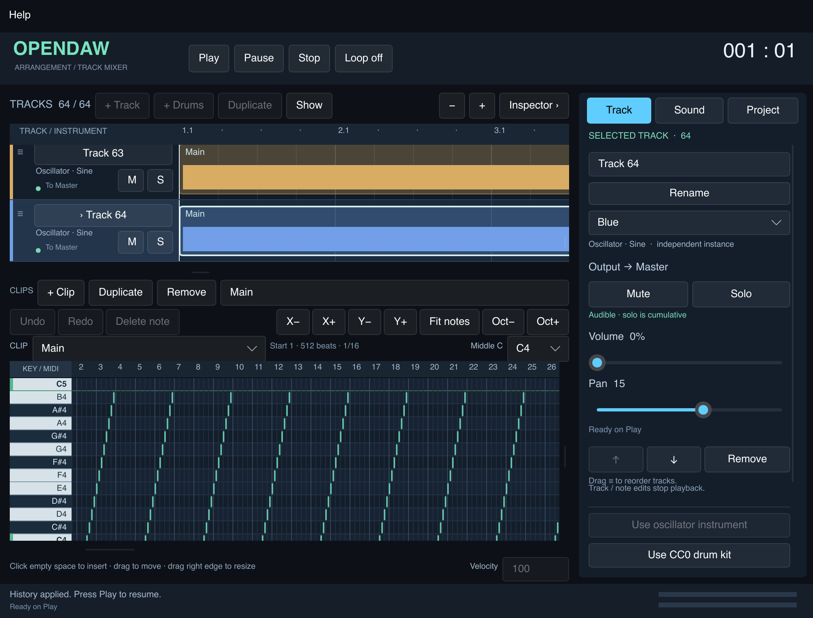

# M3.6 — 64 tracce e validazione finale disponibile

23 ottobre 2026. Checkout aggiornato:
`/Users/giorgiofausto.canu/Downloads/OpenDAW_Interactive`.
Baseline M3.5 `50de0cf`; implementazione M3.6 **`c4a8242`**.
Le evidenze di questa iterazione sono `evidence/m36-*`; quelle precedenti restano
inalterate. Nessun recupero del vecchio ZIP o aggiornamento di dipendenze/lockfile.

**Supporto a 64 tracce implementato e verificato nel software disponibile.**
La chiusura dell'intero DoD M3 resta distinta: Windows, macOS Intel, alcune prove
hardware/manuali e l'ascolto del kit non vengono dedotti dal passaggio su questo Mac.

## Comportamento e uso

- Fino a **64 tracce** in modello Rust, bridge, C ABI e motore. Header, arrangement,
  selezione, inspector, ordine, mute/solo, clip, synth e kit restano gli stessi.
- A 64 tracce, + Track, + Drums e Duplicate sono disabilitati. Il modello e il
  motore rifiutano comunque una 65ª traccia senza troncare o sostituire il progetto.
- Le istanze rimangono indipendenti: note/preset/voci/choke non diventano condivisi.
  64 kit factory possono condividere gli stessi campioni immutabili entro il budget.
- Il formato resta v2, con limiti invariati di 100.000 note, 4.096 clip, 24 ore e
  128 MiB di media decodificati. Versioni precedenti con limite 16 possono rifiutare
  questi progetti: nessuna promessa di compatibilità inversa per file più grandi.
- Nessun cambio al comportamento strutturale: riordino, duplicazione e modifiche
  strutturali fermano il playback. Parametri live, mute/solo e metadati mantengono
  i contratti delle milestone precedenti.

Aprire nell'app **examples/Sixty-four-tracks.opendaw** per una fixture riproducibile
con 64 tracce e 1.024 note. Per creare quella da 100.000 note:

```sh
cargo run --manifest-path app/Cargo.toml --locked --no-default-features --release \
  --example capacity_probe -- --fixture /tmp/OpenDAW-64-large.opendaw 100000
```



## Modifiche e real-time

`MAX_TRACKS` Rust e `MaxTracks` C++ sono 64. La UI riceve il limite dal presenter,
anziché mantenere un secondo valore 16. `OD_MAX_TRACKS` e l'API additiva
`od_track_capacity()` permettono al bridge di verificare la capacità del backend
prima di creare un handle. Versione ABI 1 e layout precedenti restano validi;
le strutture pad conservano 16 slot, perché il numero di pad non è il numero di tracce.

La crescita non moltiplica sullo stack lo storage degli eventi e della coda mix:

| Storage, build arm64 | Dimensione | Lifetime |
|---|---:|---|
| Oggetto EngineService | 61.568 byte | stack o heap del proprietario |
| Eventi, 64 × 320 × sizeof(BlockNoteEvent) | 327.680 byte | heap preparato, solo letture/scritture nel render |
| Coda mix, otto snapshot più slot sentinella | 207.680 byte | heap preparato, SPSC invariata |

`events_` viene dimensionato una volta durante prepare; la coda è posseduta da
`unique_ptr`. Nessun resize/ownership swap nel callback. Un assert di compilazione
impone `sizeof(EngineService) < 96 KiB`. La misura Clang dello stack nella build
strumentata dà 68.496 byte per consumeMix, 176 per block e 62.400 per l'export che
contiene un servizio locale. Sono misure arm64, non misure del compilatore MSVC.

Il bridge verifica una sola volta per prepare ciascun hash factory già presente
in memoria immutabile. Le sorgenti **File** vengono ancora verificate prima della
deduplicazione, anche se dichiarano un hash già caricato da un factory o da un
altro percorso. Un test contraffa una sorgente File dopo il factory e verifica che
il caricamento fallisca lasciando il servizio corrente in riproduzione.

Dopo molte ricostruzioni, macOS tratteneva pagine libere dell'allocatore. È stata
aggiunta una restituzione periodica tramite `malloc_zone_pressure_relief`, ogni
16 preparazioni riuscite sul thread di controllo, dopo il rilascio dei vecchi owner.
Il contatore è thread-local e copre anche handle ricreati. Su altri sistemi non
viene introdotta una policy allocator. Non è una garbage collection di asset e
non si esegue nel callback; l'export e gli owner ancora attivi rimangono validi.

Stop/Panic, epoche preview, limiti di densità, coda a otto snapshot e budget media
restano invariati. I comandi raggiungono gli slot verificati per identità; il
controllo della traccia 64 non usa un array frontend ancora limitato a 16.

## Test funzionali e regressioni

Host: **Apple M4 Pro, macOS 15.6.1 arm64**, AppleClang 17, CMake 4.4.4,
Rust/Cargo 1.99.1, Slint 1.18.1. Dati macchina in [m36-host.txt](../evidence/m36-host.txt);
[indice delle evidenze](../evidence/m36-README.md).

- **36 unit test headless + 9 integration; 55 unit con UI + gli stessi 9 integration.**
  Build release UI/CLI, esempio v1 validato/renderizzato. I test dei kit sono
  estesi a 64 istanze, con verifica numerica dell'uscita e budget media rispettato.
- **Otto suite CTest su macOS**: core, service, ABI C, capacità 64, drums, synth,
  allocation probe e audit runtime. Su sistemi senza l'interposer Mac le suite sono sette.
- La nuova suite nativa usa 64 tracce miste e 512 voci iniziali, confronta 25
  partizioni casuali bit-identiche, prova Stop in un blocco con coda note piena,
  controllo dell'ultimo slot, load 65 rifiutato senza cambiare playback e
  concorrenza tra snapshot completi/preview/Stop. Le ricostruzioni ripetute
  esercitano anche il rilascio delle pagine sul controllo.
- Save/load/reorder/undo/redo/export verificati a 64; fixture da 100.000 note
  serializzata e ricompilata senza troncamento. Gli snapshot live producono lo
  stesso WAV di una nuova preparazione; all-muted export è silenzioso.
- Client shared Python e puro C verificano ABI/layout, WAV, generazioni,
  backpressure, proprietà dei buffer, export e ciclo di vita. La fixture v1 resta
  **byte-identica**, 1.536.044 byte, SHA-256
  `c5e43d8f56299da06bdc6e2c167ba0690cb858f48cf70c2df676a86f4d501426`.
- Rieseguiti i 75 casi FFT del synth, a 44,1/48/96 kHz fino a 7.040 Hz, con
  riferimento additivo e confronto con forma ingenua; esito nel JSON delle evidenze.
  Non vengono equiparati a un ascolto di sweep/PWM o a una nuova prova timbrica.

## Audit RT, sanitizers e memoria

L'allocation probe ora usa **64 tracce** con synth, sampler, kit, choke, parametri,
seek, overflow/stealing e cancellazione preview. 10.001 render: zero new/delete C++.
Su macOS un interposer di test separato intercetta malloc/calloc/realloc,
posix_memalign/free e lock pthread mutex/rwlock. Il controllo positivo dimostra
che le chiamate introdotte apposta vengono rilevate; nel tratto monitorato:
**zero chiamate di allocazione, deallocazione o lock intercettate**.
L'interposer non è collegato all'app e non si combina ai sanitizers.
Non equivale all'intercettazione di ogni syscall, primitiva allocator o lock del sistema.
L'ispezione dei percorsi completa il controllo: decode, filesystem, hash, cache e
rilascio delle risorse rimangono sul controllo, con stop/join prima dei replace.

ASan/UBSan: sette suite coperte. TSan: service, capacità 64 e drums concorrenti;
la capacità finale è rieseguita dopo l'aggiunta del rilascio memoria. Il precedente
test di rifiuto a 17 tracce è aggiornato al nuovo limite 65, poi rieseguito sotto
entrambi i sanitizers. I log iniziali sono conservati con il loro esito originario.
Il runtime Apple non supporta LeakSanitizer: ASan usa detect_leaks=0. Come controllo
separato, **leaks --atExit** sul probe memoria riporta zero leak, zero byte persi.

Probe memoria: 300 cicli preset/duplica/elimina/undo/redo, documento a 63/64 tracce,
kit factory residente, storia conservata e limitata a 512 step, export indipendente
concorrente e sovrapposizione di preparazioni vecchia/nuova.

| Misura | Prima del rilascio pagine | Implementazione finale |
|---|---:|---:|
| RSS al ciclo 100 | 160.071.680 B | 117.784.576 B |
| RSS al ciclo 300 | 223.068.160 B | 121.225.216 B |
| Crescita RSS 100→300 | 62.996.480 B | 3.440.640 B |
| Heap malloc attivo al ciclo 100 | 34.987.152 B | 28.235.568 B |
| Heap malloc attivo al ciclo 300 | 36.039.504 B | 27.801.664 B |

Sono due esecuzioni distinte dello stesso carico, con variabilità dell'allocatore
ed export concorrente. Il primo check RSS falliva; l'indagine e leaks hanno
separato oggetti attivi e pagine libere trattenute. **Non è stata alzata la soglia
RSS per nascondere il risultato**: dopo il warmup il gate resta ≤32 MiB di crescita
RSS; heap attivo ≤8 MiB includendo la storia limitata. La prova finale li rispetta.
Picco RSS della prova finale 176.095.232 B; physical footprint peak nella prova
separata leaks 56,9 M come riportato dallo strumento. RSS, footprint e budget 128 MiB dei media sono misure
diverse; vecchi grafi, cache, runtime e export sono memoria aggiuntiva.

## UX e prestazioni UI

Software renderer release collegato al vero controller, 64 tracce / 100.000 note,
**1.490 note visibili**, 120 operazioni per configurazione. Tempi end-to-end fino
al paint per selezione/scroll/zoom, più tempo del solo draw software su buffer
preallocato. File/screenshot e preparazione del progetto sono fuori dal tratto.

| Finestra logica / scala | Risposta p95 / max ms | Frame software p95 / max ms |
|---|---:|---:|
| 1280×820 / 100% | 15,092 / 15,745 | 4,200 / 6,717 |
| 1000×760 / 100% | 14,376 / 15,352 | 3,474 / 5,047 |
| 1000×760 / 200% | 16,192 / 18,032 | 5,378 / 7,134 |

Gate rispettati su questo host: risposta p95 ≤50 ms, frame p95 ≤16,7 ms, nessuna
operazione misurata oltre 100 ms. Il probe controlla i divisori di tutte le righe
visibili entro un pixel logico dall'inizio alla fine, dopo riordino e Undo.
Mostra selezione raggiunge la traccia 64. Limite pulsanti, Help/About, interazioni
M3.2–M3.5 e 1.000 aggiornamenti slider sulla traccia 64 restano verificati;
ultimo target applicato dal motore e conservato dopo Stop. Queste misure non sono
frame GPU della GUI nativa né una prova completa di Tab/accessibilità/menu macOS.

## Audio e carico riproducibile

Build Release **OD_MEASURE_RENDER=ON**, separata dai binari normali. Due clock per
blocco e vettore di misure preallocato/limitato; nessun clock di profiling nelle
build normali. Risultati letti dopo la quiescenza. Saturare il buffer o una durata
incompatibile con i frame elaborati rende la prova non valida.

Carico 32: 16 synth (saw, square/PWM 0,1/0,9, triangle), 8 kit e 8 sampler;
**8 voci per synth**, otto voci principali per sampler/kit e hi-hat con choke
periodico. Campione stereo sintetico residente condiviso di 10 secondi, non WAV
factory; loop di 8 secondi. Carico 64 raddoppia le istanze. Niente filesystem/decode
nel render. Sessione a 48 kHz, blocchi DSP interni fino a 256 frame. Gain traccia
0,001 per l'uscita nativa, 0,012 nella prova paced headless; livello dichiarato,
non una differenza nel numero di voci. Il benchmark non misura la latenza round-trip.

Uscita CoreAudio predefinita: **MacBook Pro Speakers, nominalmente 48 kHz**.
Non viene modificato il buffer hardware globale: un callback dispositivo può
contenere più blocchi DSP interni da 256. Non certifica un I/O hardware impostato
fisicamente a 256 né tutte le latenze del driver.

**Gate nativo 32 tracce / dieci minuti: PASS** sul codice `c4a8242`.
Finestra continua di 600,064 s, 600,011 s di audio e 112.502 blocchi misurati:
p95 **1,499 ms**, p99 **1,573 ms** (29,49% del budget), massimo **3,014 ms**.
Zero blocchi oltre il proprio budget, errori dispositivo, notifiche CoreAudio di
processor overload e campioni clipped. Gate p99 <3,2 ms e massimo <5,333 ms
rispettati. Prepare 47,165 ms sul controllo. Il controllo automatico e il JSON
originale sono in `m36-performance-acceptance.log` e `m36-coreaudio32-600.jsonl`.
Il dato è una singola prova su questo host/dispositivo, non una garanzia su altri
carichi, host o impostazioni hardware.

**Stress nativo 64 tracce / un minuto:** finestra continua 60,066 s,
60,011 s audio, 11.252 blocchi; p95 **1,801 ms**, p99 **2,002 ms**, massimo
**2,896 ms**. Zero blocchi oltre budget, errori dispositivo, notifiche di processor
overload e campioni clipped. Prepare 49,561 ms; stesso tipo di campione, otto voci
per synth, 32 synth + 16 kit + 16 sampler. È una prova breve di capacità sotto
questo carico, non il gate dieci minuti né una promessa di qualsiasi sessione a 64.
[JSON 32 tracce](../evidence/m36-coreaudio32-600.jsonl),
[gate 32](../evidence/m36-performance-acceptance.log),
[JSON 64 tracce](../evidence/m36-coreaudio64-60.jsonl),
[exit code](../evidence/m36-soak-status.json).

La prova preliminare paced headless non costituisce il gate finale: 1.231 s
trascorsi e ~406 s audio non sono una finestra continua da 600 s. Il log è
conservato come tentativo non valido; i valori fuori soglia non vengono nascosti.
La verifica automatica rifiuta esplicitamente questo record. Lo stress headless
64/30 s sotto altro carico era continuo, p99 2,502 ms, massimo 10,222 ms e nove
blocchi oltre budget: non è presentato come promessa di 64 tracce senza glitch.
Le misure native finali sono riportate separatamente sopra.

Un test CoreAudio breve e dieci start/stop reali passano senza errori; dopo stop/join
il contatore render resta fermo. Le notifiche di processor overload sono rilevate
tramite la proprietà ufficiale CoreAudio e non equivalgono a conoscere ogni
underrun interno di ogni driver. Il campo device_underruns rimane null quando
non esiste quella telemetria; non viene convertito falsamente in zero.

## Riproduzione dei gate

```sh
bash scripts/validate_app.sh
bash scripts/validate_native.sh build/macos-validation
python3 scripts/verify_factory_drums.py
cargo run --manifest-path app/Cargo.toml --locked --release --example layout_probe
cargo run --manifest-path app/Cargo.toml --locked --no-default-features --release \
  --example capacity_probe
# Su questo Mac, controllo leak separato, senza ASan/interposer:
leaks --atExit -- app/target/release/examples/capacity_probe

cmake -S . -B build/m36-measure -DCMAKE_BUILD_TYPE=Release \
  -DBUILD_TESTING=OFF -DOD_MEASURE_RENDER=ON
cmake --build build/m36-measure --config Release --target performance_probe --parallel 4
# Su macOS: niente altri stress test durante questa prova; caffeinate evita l'idle sleep.
caffeinate -i build/m36-measure/performance_probe 32 600 --native > /tmp/m36-32.jsonl
python3 scripts/verify_m36_performance.py --require-coreaudio /tmp/m36-32.jsonl
build/m36-measure/performance_probe 64 60 --native
build/m36-measure/performance_probe --lifecycle
```

Windows: eseguire validate_native.ps1, gate Cargo con lockfile e poi il target
measurement Release/performance_probe.exe. Non usare caffeinate o il requisito
CoreAudio su Windows. I risultati WASAPI/underrun richiedono una prova su quel
sistema, non sono stati ottenuti qui. CI aggiunge la compilazione del target
measurement ai tre sistemi; non è stata eseguita tramite push in questa iterazione.

## Stato finale della matrice e DoD

| Area | Stato effettivo |
|---|---|
| Modello/ABI, 64 tracce, save/undo/export | Verificato su macOS arm64 |
| UI software, limiti, scroll/riordino, 100/200%, 100k note | Verificato |
| Antialias statico, smoothing e regressioni native | Verificato automaticamente; ascolto sweep/PWM ancora aperto |
| Heap/lock intercettati nel render, ASan/UBSan, TSan, leaks | Verificato nei percorsi e carichi dichiarati |
| CoreAudio reale e ciclo start/stop | Misure riportate sopra; ascolto umano non attestato |
| Buffer hardware 256, 44,1 kHz reale, sleep/wake, cambio/rimozione device | Non validati in questa sessione |
| GUI nativa: menu macOS, Tab/focus/accessibilità completi | Non coperti dal renderer software |
| Windows x64: MSVC/Rust/UI/WASAPI, Unicode/replace, audio 10 min | Non eseguito; compatibilità non certificata |
| macOS Intel | Non eseguito |
| Linux native output | Adapter ancora non implementato; silent clock esplicito |
| Kit 12 suoni CC0 | Hash/licenze verificati; scelta approvata provvisoriamente dall'utente **senza ascolto** |

L'utente accetta il kit corrente per questa iterazione e potrà sostituirlo in
seguito. Non viene trasformata questa decisione in un'attestazione di ascolto o
qualità timbrica: il manifest lo registra esplicitamente. La chiusura dell'intero
M3 resta aperta per i gate manuali/target mancanti; non è una release multipiattaforma
certificata. I limiti residui M3.5 (MIDI esterno, routing/plugin condivisi, kit preset,
velocity layers, step sequencer, file picker) non vengono implicitamente implementati.
